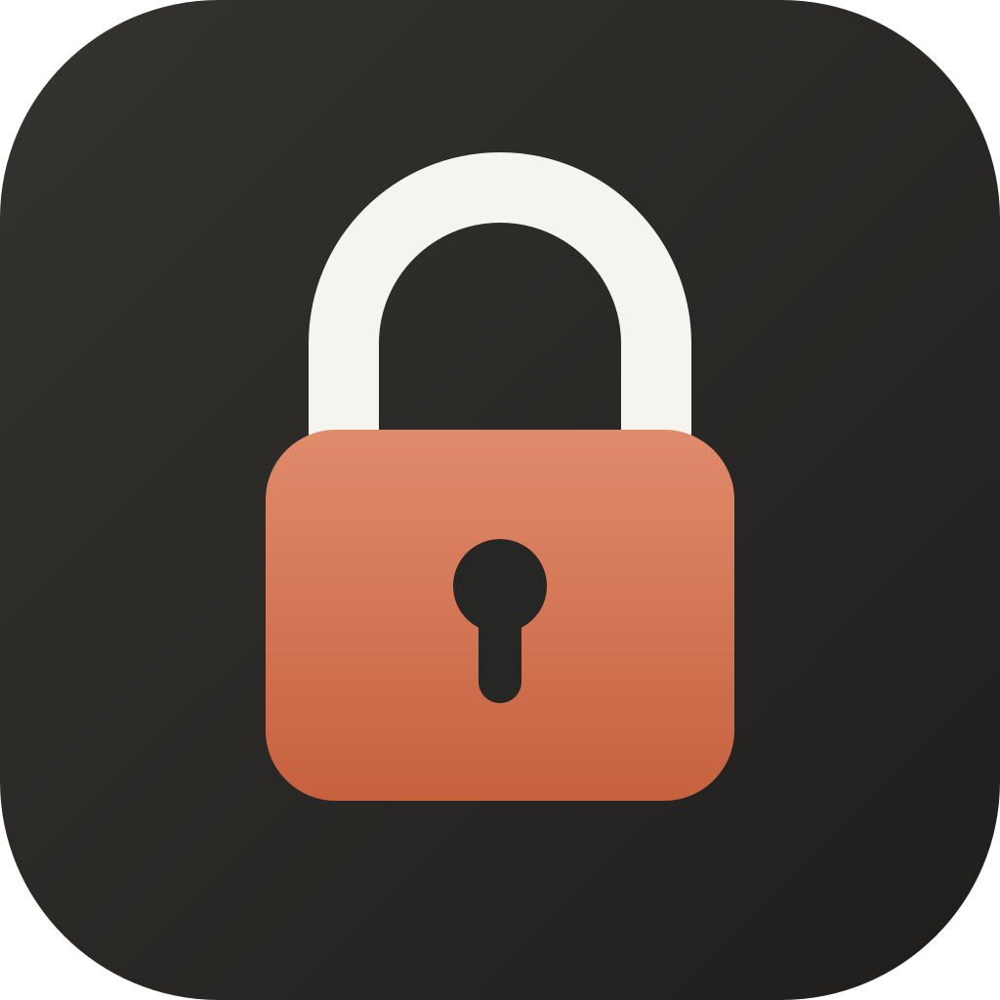

<p align="center">
  
</p>

<h1 align="center">GetLocked</h1>

<p align="center">
  <strong>Sit down, open your work, lock in until it's done.</strong><br />
  A free, open-source focus app for Windows that blocks the apps and websites you choose for a session.
</p>

---

## What it does

- **Block apps** like Steam, Discord or game launchers, or flip it around and **allow only** the apps you need (for example, VS Code and Chrome). Anything else gets closed the moment it opens.
- **Block websites** like YouTube or Reddit, or allow only the sites you need, through a small browser extension for Chrome, Edge, Brave, Opera, Vivaldi and Firefox.
- **Timer or stopwatch.** Count down from a set time, or count up with no limit and stop when the work is actually done. When a timer runs out, you choose: *I'm done* or *keep going*.
- **Pick how strict it is** for each session:
  - **Easy:** end any time.
  - **Friction:** to end early, wait 30 seconds and then type a long random code by hand. Pasting doesn't work.
  - **Hard:** no ending early. The session survives closing the app and restarting the PC.
- **Presets** for your usual setups, **scheduled sessions** (e.g. weekdays at 9:00), optional **Pomodoro breaks**, and **local stats and streaks**.

## What it doesn't do

GetLocked **never modifies other apps or system files.** There's no hosts-file editing, no admin rights, no Windows service, and no drivers. While a session is running it watches which apps open, asks the ones that break your rules to close (falling back to ending the process if they don't), and tells the browser extension which sites to block. Once the session ends, nothing is left behind.

It also never sends your data anywhere. There's no account, no telemetry, and no network access beyond a local connection between the app and its own browser extension on `127.0.0.1`. See [How it works](docs/how-it-works.md) for the full list of what it touches.

## Install

1. Download `GetLocked_x.y.z_x64-setup.exe` from the latest [release](../../releases/latest) and run it. No admin rights are needed.
   > Windows may say **"Windows protected your PC"** because the installer isn't code-signed yet. Click **More info → Run anyway**. The source and the build are public, so you can check exactly what you're running.
2. For website blocking, open GetLocked → **Settings → Browser extension → Set up extension** and follow the steps ([details](docs/extension.md)).
3. Pick what to block and press **Lock in**.

More detail: [Getting started](docs/getting-started.md) · [FAQ](docs/faq.md)

## Building from source

You need [Rust](https://rustup.rs) (stable), [Node.js](https://nodejs.org) 22+, and the [Tauri prerequisites for Windows](https://tauri.app/start/prerequisites/) (WebView2 is already on Windows 10/11).

```bash
npm install
npm run dev          # run the desktop app with hot reload
npm run ext:build    # build the extension into extension/dist/{chromium,firefox}
npm run build        # build the Windows installer
```

Tests:

```bash
cargo test --workspace
npm test
```

The code layout is explained in [Architecture](docs/architecture.md).

## Platform support

Windows 10 and 11 today. The blocking code sits behind a small per-OS interface, so macOS and Linux support can be added. See [Adding a new OS](docs/architecture.md#adding-a-new-os). Contributions are welcome.

## Contributing

Bug reports, ideas and pull requests are welcome. See [CONTRIBUTING.md](CONTRIBUTING.md).

## License

GetLocked is free software under the [GNU General Public License v3.0](LICENSE). You can use, study, share and change it, and any modified versions you distribute must stay open under the same license.
